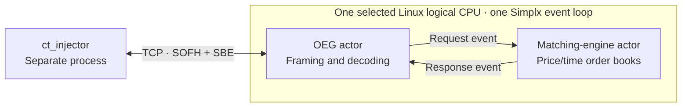

# Compute Trade

A demonstration exchange for computation resources, built with
[Simplx](https://github.com/rthickling/simplx). The project supports learning and a
live C++ London presentation about exchange implementation and CPU caches.

The first milestone provides a TCP order-entry gateway (OEG) and matching engine,
each implemented as a Simplx actor on the **same pinned event loop**. A separate
injector sends SBE-encoded limit orders and checks acknowledgements.



Supported behaviour:

- Instruments `1` and `2`, with independent books.
- Buy/sell limit orders using integer price ticks and whole quantity units.
- Best-price priority, FIFO within a price level, and execution at the resting
  order's price. Unfilled quantity rests in the book.
- Exchange-generated order IDs and one acknowledgement reporting the incoming
  order's executed and remaining quantities.
- Business rejections, connection-scoped duplicate client-ID detection, TCP
  fragmentation/coalescing, and bounded transport buffering.

The wire schema is a small demonstration protocol. It is not the Optiq protocol.
This milestone has no cancel/amend, maker fill notifications, market-data feed,
authentication, persistence, or recovery. CPU isolation, Redzone scheduling, and
cache-performance experiments come later.

## Build and test

Requirements: Linux, CMake 3.28 or newer, Ninja, a C++26 compiler such as
`g++-16`, and Python 3 for the integration tests. `just` is optional. The local
compiler used for development is GCC 16.0.1.

The default dependency path is `../simplx`. From the Compute Trade repository
root, create a fresh sibling checkout if needed:

```sh
git clone https://github.com/rthickling/simplx.git ../simplx
git -C ../simplx checkout c0b2ca712f1c187b6c120d5bcaf441bdff1600ae
```

That revision is the implementation baseline used here. Compute Trade builds the
Simplx engine directly; its tutorials and Google Test submodule are not required.
An existing checkout elsewhere can be selected by adding
`-DSIMPLX_SOURCE_DIR=/absolute/path/to/simplx` to the configure command.

```sh
CXX=g++-16 cmake --preset debug
cmake --build --preset debug --parallel 2
ctest --preset debug

CXX=g++-16 cmake --preset release
cmake --build --preset release --parallel 2
ctest --preset release
```

The equivalent convenience commands are:

```sh
just test debug
just test release
just check
```

`just` defaults to `g++-16`; override with `CXX=/path/to/compiler`. Use a fresh
build directory when switching compilers.

## VS Code navigation

Open the Compute Trade folder in VS Code with Microsoft's C/C++ extension.
The workspace settings use `build/debug/compile_commands.json` for compiler
flags and include paths, and index the sibling Simplx headers and sources.
Run `just configure debug` to generate or refresh the compilation database.
Then use F12 (Go to Definition) or Ctrl-click to follow symbols into Simplx;
Shift-F12 finds references. If navigation is stale, run **C/C++: Reset IntelliSense
Database** from the Command Palette and allow indexing to finish.

If Simplx lives somewhere other than `../simplx`, configure CMake with
`SIMPLX_SOURCE_DIR` as described above and update the two Simplx browsing paths
in `.vscode/settings.json` to match.

To debug, open **Run and Debug** (Ctrl-Shift-D), select **Debug exchange (CMake)**,
and press F5. This configures the Debug preset, builds the `ct_exchange` target,
and launches it with GDB. Use this launch configuration instead of **build and
debug active file**: the exchange needs CMake's include paths, other source
files, and the Simplx library.

Set a breakpoint in `MatchingEngineActor::onEvent` in `src/exchange.cpp`. Once
the exchange prints `READY`, run `just inject 1 1` in a separate terminal to send
one order. The injector currently waits five seconds for a response, so it may
disconnect while you are stepping through the exchange.

## Continuous integration

[GitHub Actions](.github/workflows/build-and-test.yml) runs on pushes, pull
requests, and manual dispatch. It builds and tests both Debug and Release with
GCC 16.2 and Clang 22, using the same CMake presets as the local commands above.
Each job checks out Simplx at the pinned revision documented above, then runs
the codec, order-book, and real TCP integration tests. No privileged scheduling
or dedicated CPU isolation is required. The four jobs report independently,
and newer commits cancel older runs on the same branch or pull request.

## Run the demonstration

Start the exchange in one terminal:

```sh
./build/release/bin/ct_exchange
```

It defaults to `127.0.0.1:9000` and the first allowed Linux logical CPU. Its
`READY` line reports the bound port, requested CPU, and CPU observed in each
actor's constructor. The process checks that both actors started on that CPU.
Use `--core CPU`, `--bind IPv4`, or `--port PORT` to select them explicitly;
`--port 0` requests an ephemeral port. Stop with Ctrl-C after draining replies.

From another terminal:

```sh
./build/release/bin/ct_injector --count 1000 --window 64
./build/release/bin/ct_injector --count 1000 --instrument 2
```

The injector alternates buys and sells at one price, using a new TCP connection
for each invocation. `--window` controls the number sent before reading that
batch's acknowledgements. Run `ct_injector --help` for host, port, price, and
quantity options. It returns a failure exit code for rejected orders or transport
and protocol errors.

Convenience commands, also from separate terminals:

```sh
just exchange
just inject 1000 64
```

`just exchange CPU release` chooses a CPU explicitly. These recipes build first;
run the executables directly when the server is already running and no rebuild
is needed.

Injector throughput includes client processing, TCP, and the exchange. These
numbers establish a functioning path; they are not measurements of cache hit
latency or isolated matching-engine service time. The default alternating
workload deliberately keeps the live book small.

## SBE codecs

Message headers and bodies use C++ codecs generated from
[`schema/compute-trade.xml`](schema/compute-trade.xml) by the
[SBE reference implementation](https://github.com/aeron-io/simple-binary-encoding),
pinned to version 1.41.0. Generated headers are checked in, so normal builds need
neither Java nor a generator download. The adapter retains SOFH transport framing
and strict validation of the demo protocol.

After changing the schema, regenerate with Python 3 and Java 17 or newer:

```sh
python3 tools/generate_sbe.py
python3 tools/generate_sbe.py --check
```

The script downloads the pinned generator from Maven Central and verifies its
SHA-256. For offline regeneration, supply `--jar /path/to/sbe-all-1.41.0.jar`.
Set `JAVA=/path/to/java` to select a runtime. CI checks that generated headers
match the schema. See [upstream attribution](third_party/sbe/README.md).

## Tests and implementation

CTest runs SBE codec tests, matching tests, and a Python integration suite that
starts the real exchange and injector. The Python tests independently construct
and decode wire bytes, and check same-CPU startup, matching, instrument/session
separation, rejection paths, fragmented/coalesced TCP frames, pipelining,
half-close, abandoned replies, and command-line validation.

See [the architecture notes](docs/architecture.md) for actor responsibilities,
allocation, protocol details, and current limits. The main entry points are:

- [Actor implementation](src/exchange.cpp)
- [Allocator-aware order book](include/compute_trade/order_book.hpp)
- [Wire schema](schema/compute-trade.xml) and [codec](include/compute_trade/sbe.hpp)
- [External injector](src/injector.cpp)
