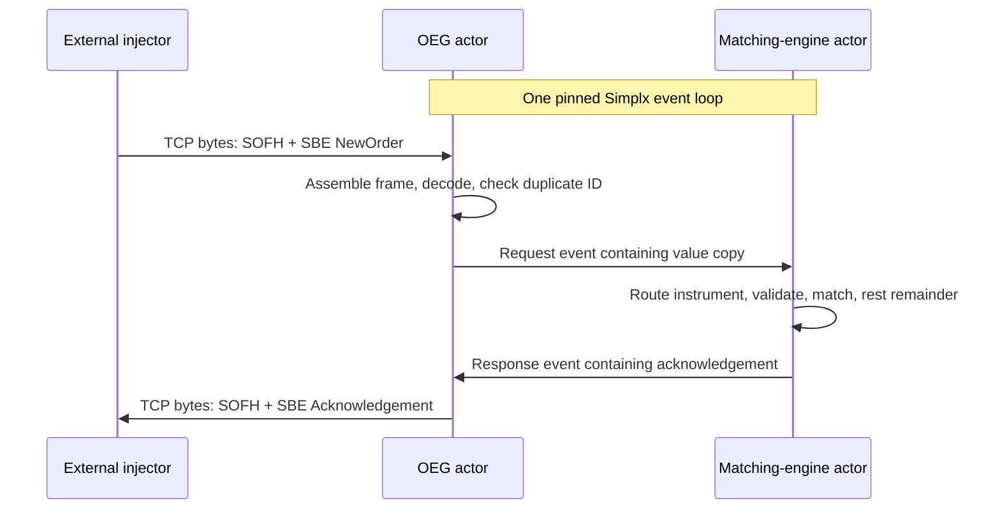

# Initial exchange architecture

The first implementation establishes an observable order path that can later be
used for cache experiments. It uses the `rthickling/simplx` fork at baseline
`c0b2ca712f1c187b6c120d5bcaf441bdff1600ae`.

## Actors and execution placement

`Exchange` constructs a Simplx `CoreSet` containing exactly one Linux logical
CPU ID, then registers the matching-engine service before the ordinary OEG actor on
that CPU. The service outlives the OEG during shutdown. Both actors execute serially on that event loop. Their constructor
calls to `sched_getcpu()` are checked against the requested CPU and reported in
the executable's `READY` line.



The arrows between actors are Simplx events; they are not direct calls between
objects. Same-loop dispatch avoids a cross-core actor hand-off on this path,
while preserving the event allocation and scheduling mechanisms we want to
study. TCP kernel work and the external client have their own execution costs.

The OEG uses nonblocking POSIX sockets in an actor callback. It accepts at most
one connection per callback and performs at most one `recv` and one `send` per
session per callback. It then registers its callback again. Parsing and in-flight
credits are bounded, allowing matching events to run between polling iterations.
A single matching request can still sweep many resting orders; matching work
depends on the book and incoming order.

Scheduling is normal Linux scheduling. Affinity pins the Simplx loop to a logical
CPU; it does not reserve that CPU, isolate its SMT sibling, move interrupts, or
enable Redzone. Inspect the machine before selecting a CPU, for example with
`lscpu -e=CPU,CORE,SOCKET,ONLINE` and `taskset -pc $$`. The runtime accepts only
CPUs allowed by its inherited affinity mask and representable by Simplx's
8-bit `CoreId` (`0..255`).

## Matching and order ownership

The matching actor owns one order book per configured instrument. The executable
enables instruments `1` and `2`; the C++ `ExchangeConfig` permits another explicit
set. Instruments do not match against each other.

Each book contains a descending map of bid prices and an ascending map of ask
prices. Every price level contains a FIFO list of resting orders. An incoming
buy consumes the cheapest eligible asks; a sell consumes the highest eligible
bids. Trades use the resting order's price. The incoming order's unfilled
remainder joins the end of its price-level queue.

This is a readable price/time-priority implementation using standard maps and
lists. Pointer traversal, node sizes, size-class rounding, and reuse will all
matter in later cache work. No cache-residency property follows merely from the
container choice or allocator.

Client order IDs must be nonzero and must not use the reserved `uint64` null
value (`2^64 - 1`). Side must be Buy or Sell, price must be positive, and quantity
must be positive and not the reserved `uint64` null value. Unknown instruments
are rejected. Every accepted order receives a unique increasing exchange order
ID across the process, starting at `1`. IDs are not reused during that process;
a restart starts the sequence again.

Duplicate client IDs are scoped to a TCP connection. A syntactically decoded,
nonzero client ID is consumed even when its order is subsequently rejected.
Reusing it on the same connection yields `DuplicateClientOrderId`. A new
connection may start at client ID `1` again.

For an accepted incoming order:

```text
executed_quantity + remaining_quantity = submitted_quantity
```

The acknowledgement is a snapshot after processing that incoming order. A later
trade against its resting remainder currently produces no notification to that
maker. The book exposes a synchronous trade callback for unit tests, but the
matching actor does not yet publish those trades externally. This milestone has
no cancel, amend, market orders, session authentication, or trading-phase model.

## Two allocation contexts

The matching actor obtains `Actor::Allocator` from `getAllocator()`. Its
instrument map, price maps, and FIFO lists explicitly use that allocator,
including the nested lists. Allocating the outer map with an actor allocator
alone would not redirect the inner list's allocations. The OEG also uses its
actor allocator for session-list nodes and duplicate-ID sets.

Those allocations belong to the event loop and are allocated, accessed, and
freed there. Resting state contains owned copies of order information, so it
survives the delivery of the event that created it.

`Event::Pipe::push<Request>` and `push<Response>` use Simplx's separate event
allocator. Events carry small value payloads and are reclaimed under Simplx's
event-lifetime rules. The implementation retains no pointer into a delivered
event. In this milestone both ends are on the same loop; cross-core market-data
delivery will be a later extension.

Neither allocator pins storage into L1, L2, or L3. Determining cache behaviour
requires measurements of the repeatedly accessed working set and actual memory
accesses.

## Wire protocol

[The XML schema](../schema/compute-trade.xml) describes two fixed-size SBE
messages, using schema ID `1`, schema version `0`, and a little-endian message
header and body. [The codec](../include/compute_trade/sbe.hpp) is handwritten and
bounded; generated codec compatibility has not been claimed. It accepts exactly
the layouts below, with strict version, template, block-length, and frame-length
checks. Future extensions require an explicit implementation change.

Each TCP frame starts with the six-byte Simple Open Framing Header (SOFH):

| Offset | Field | Encoding |
|---|---|---|
| 0 | Message length, including SOFH | `uint32`, big endian |
| 4 | Encoding type | `uint16`, big endian, `0xEB50` |

The following eight bytes are the SBE header: `uint16` block length, template ID,
schema ID, and schema version, all little endian. Message field offsets below
are relative to the start of the body after both headers.

| NewOrder field | Offset | Type |
|---|---:|---|
| Client order ID | 0 | `uint64` |
| Instrument ID | 8 | `uint32` |
| Side | 12 | `uint8`: Buy=1, Sell=2 |
| Price | 13 | `int64` |
| Quantity | 21 | `uint64` |

NewOrder uses template ID `1`, block length `29`, and total frame size `43`.

| Acknowledgement field | Offset | Type |
|---|---:|---|
| Client order ID | 0 | `uint64` |
| Exchange order ID | 8 | `uint64` |
| Instrument ID | 16 | `uint32` |
| Status | 20 | `uint8`: Accepted=0, Rejected=1 |
| Reject reason | 21 | `uint8` |
| Executed quantity | 22 | `uint64` |
| Remaining quantity | 30 | `uint64` |

Acknowledgement uses template ID `2`, block length `38`, and total frame size
`52`. Reject reasons are None=0, MalformedMessage=1, InvalidOrder=2,
UnknownInstrument=3, and DuplicateClientOrderId=4. Rejections carry exchange
order ID `0` and zero executed/remaining quantity.

Invalid SOFH encoding or a declared frame length outside `14..256` closes the
offending connection. A complete frame with valid SOFH but invalid SBE layout
gets a malformed-message acknowledgement with client ID `0` because the request
could not be reliably decoded. Rejections follow the same actor path as accepted
orders, preserving response order within a connection.

## Buffering, disconnects, and failure limits

The OEG permits at most 16 active sessions. Each session has a fixed 2,048-byte
receive buffer, 32 acknowledgement slots, and 32 outstanding credits shared
between pending matching requests and replies awaiting transmission. Reads and
parsing pause as credits fill, allowing TCP backpressure to reach the sender.
Partial reads/writes are retained across callbacks. Excess accepted connections
are closed immediately.

When a client half-closes its write side, complete requests already buffered are
processed and their replies drained. An incomplete trailing frame is discarded
when the session closes. After a disconnect, already-submitted orders may still
be processed and resting orders remain in the book; replies for a removed
session are discarded. Internal session IDs are never reused, preventing a late
reply from reaching a new connection.

Transport buffers are bounded, but resting books and the per-session duplicate-ID
sets can grow with accepted traffic and connection lifetime. There is no book
capacity limit or deduplication-retention policy yet.

Allocation failures, actor exceptions, and unexpected listener failures mark the
whole demo as failed and stop it. Matching is not transactional under allocation
or trade-callback failure: fills already applied are not rolled back. Recovery,
durability, replication, and exchange-grade admission controls remain future
work.

## What the current tests establish

- Codec tests check known byte vectors, round trips, bounds, and malformed input.
- Book tests check price/time priority, maker prices, partial fills, sweeps,
  invalid orders, large quantities, and use of a stateful allocator.
- Python integration tests independently encode/decode the wire format and run
  the real TCP actors, including the external injector, same-CPU startup,
  independent instruments and sessions, rejects, fragmentation, pipelining,
  half-close, and disconnects with work outstanding.

The injector alternates same-price buys and sells, so its default workload keeps
the live book small. Its reported throughput uses client wall time and includes
socket calls, protocol work, event dispatch, and matching. Increasing the message
count or rate alone does not establish an L1-to-L2-to-L3-to-memory transition.
Later experiments must vary the actively touched book state separately from
arrival rate and distinguish cache effects from queue growth.
